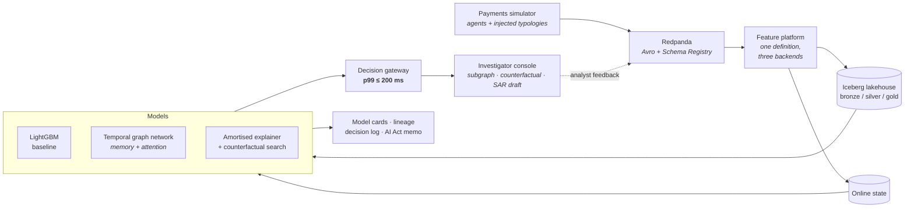

<h1 align="center">KONTOGRAPH</h1>

<p align="center">
  <strong>Real-time anti-money-laundering detection for SEPA Instant payments.</strong><br>
  A streaming decision system that scores, explains and logs every payment inside a 200 ms budget —<br>
  with the evaluation machinery to show that its numbers, and its explanations, hold up.
</p>

<p align="center">
  <a href="https://github.com/aabolfadl/kontograph/actions/workflows/ci.yml"></a>
  
  
  <a href="docs/evaluation-protocol.md"></a>
  <a href="docs/adr/"></a>
  <a href="paper/kontograph.pdf"></a>
  <a href="LICENSE"></a>
</p>

---

## The problem

Regulation (EU) 2024/886 made **SEPA Instant** credit transfers mandatory across
the euro area: a euro payment between any two accounts must settle in **under
ten seconds**, around the clock, with no upper amount limit and mandatory
**Verification of Payee** (VoP). Before this, the settlement delay was doing
invisible work. It gave banks an overnight batch window to look for suspicious
patterns, and it gave them time to _recall the money_ when they found one.

Both are gone. Settlement is irrevocable within seconds, and laundered funds are
typically forwarded on immediately. Detection therefore has to happen _inside_
the payment, while the customer waits, and speed alone is not sufficient:

- **The decision has to be right.** Blocking a legitimate salary payment is a
  serious harm in its own right, and an institution's investigation team has a
  fixed daily capacity.
- **The decision has to explain itself.** GDPR Art. 22 gives a person subject to
  an automated decision the right to meaningful information about the logic
  involved, and a suspicious-activity report (_Verdachtsmeldung_) filed with the
  FIU must state grounds. "The model said so" is not a report.
- **The explanation has to be faithful** to what the model actually did, which
  is the requirement most systems leave unmeasured.

KONTOGRAPH implements that system end to end — simulator, event stream,
lakehouse, feature platform, models, serving gateway, governance artifacts and
investigator console — together with the evaluation machinery that makes its
reported numbers checkable.

An accompanying paper, [_Verified Point-in-Time Feature Consistency and Amortised
Explanation for Real-Time Anti-Money Laundering under a 200 ms Decision
Budget_](paper/kontograph.pdf), reports the empirical study.

---

## Results

Every number in this section is regenerated from stored artifacts by
`kg eval report`. None is typed by hand.

### Does a graph model beat a tabular one?

The central hypothesis: **a payment is not a row in a table, it is an edge
between two accounts.** A money mule looks ordinary in isolation — small amounts,
plausible timing. It only looks wrong in _formation_: money fanning in from a
dozen accounts and straight out to one, within hours.

The ablation ladder adds one idea per rung. All rungs are scored on the same
held-out test fold of 303,129 payments:

| #   | Model                | What it adds                                  | PR-AUC (95% CI)             | Recall @ 200 alerts/day |
| --- | -------------------- | --------------------------------------------- | --------------------------- | ----------------------- |
| 0   | Constant             | Nothing — a chance-level reference            | 0.0001 [0.0001, 0.0002]     | 4.5%                    |
| 1   | LightGBM             | Gradient-boosted trees on 29 features         | 0.0053 [0.0030, 0.0079]     | 90.9%                   |
| 2   | + static graph       | Degree and counterparty-structure features    | 0.0144 [0.0064, 0.0319]     | 79.5%                   |
| 3   | + temporal graph net | Temporal attention over the payment network   | 0.0734 [0.0348, 0.1353]     | 77.3%                   |
| 4   | **+ memory**         | A learned per-account memory (full TGN)       | **0.1717 [0.1011, 0.2445]** | **90.9%**               |

**The temporal graph network wins.** Rung 4 beats rung 1 by **+0.166 PR-AUC,
95% CI [0.105, 0.241]** (paired, day-blocked bootstrap) — an interval well clear
of zero. Per-account memory alone more than doubles the score (0.073 → 0.172).
The commitment to publish a negative result if this had gone the other way is in
the [evaluation protocol](docs/evaluation-protocol.md), committed before any
model was trained.

<details>
<summary><strong>Why PR-AUC, and how to read these numbers</strong></summary>

<br>

Roughly **0.2% of the simulated payments are criminal**, and only a fraction of
those were ever _confirmed_ — in the test fold, **44 of 303,129 payments carry a
fraud label** (0.015%). A model that always answers "not fraud" is 99.985%
accurate and useless, so accuracy and ROC-AUC are not reported as headlines.

**PR-AUC** summarises the precision–recall trade-off: _precision_ is the share
of flagged payments that were criminal, _recall_ the share of criminal payments
that were flagged. A perfect model scores 1.0; **chance scores 0.0001 here**,
which is exactly what rung 0 measures. 0.17 is therefore more than a thousand
times better than chance.

**Confidence intervals** are computed by bootstrapping whole **days** rather
than individual payments, because payments on the same day are correlated;
treating them as independent would make the intervals look far more precise
than they are.

</details>

### PR-AUC and the operating point disagree

Rung 2 has nearly three times rung 1's PR-AUC, yet costs **2.6× more** at the
operating point (€53,529 against €20,459 per 10,000 payments) and catches less
(79.5% against 90.9%).

PR-AUC averages over every possible threshold; an institution runs exactly
**one**, set by how many alerts its investigators can review — here 200 per day.
A model that ranks better on average can be worse at the only setting anyone
uses. **Expected cost in euros is the decision metric; PR-AUC is a diagnostic.**
The cost model — the cost of a missed fraud, of an investigation, of customer
friction — was frozen before any model was trained.

### Latency

The full decision path, measured over 2,000 payments (`kg serve smoke --events 2000`):

| Stage          | What happens                             | p50         | p99         |
| -------------- | ---------------------------------------- | ----------- | ----------- |
| Fetch features | Read the account's online state          | 1.84 ms     | 4.67 ms     |
| Assemble graph | Pull the bounded temporal neighbourhood  | 0.00 ms     | 0.01 ms     |
| Score          | Run the model                            | 0.42 ms     | 1.78 ms     |
| Explain        | Amortised explainer (alerts only)        | 0.00 ms     | 1.87 ms     |
| Counterfactual | Budgeted counterfactual search           | 0.00 ms     | 3.59 ms     |
| **Total**      |                                          | **2.71 ms** | **7.97 ms** |

**p99 of 7.97 ms against a 200 ms budget — roughly 25× headroom.**

Percentiles are _nearest-rank_: a latency some real request actually
experienced, not an interpolated value no request saw. (With 99 fast requests
and one 900 ms outlier, interpolation reports 14 ms.) The explain and
counterfactual medians are zero because only alerts are explained — 98 of the
2,000 payments. Repeated runs on a loaded laptop vary between 3.6 and 8.0 ms;
the claim is the order of magnitude of headroom, not the exact figure.

### The explainer: fast, and not yet measurable

|                                           |              |
| ----------------------------------------- | ------------ |
| Perturbation-based explainer ("teacher")  | **575.6 ms** |
| Amortised explainer ("student")           | **2.38 ms**  |
| Speed-up                                  | **241×**     |
| Agreement with teacher (top-5 Jaccard)    | 0.904        |
| Agreement with teacher (Spearman)         | −0.038       |
| **Median candidate edges per instance**   | **1.0**      |

**The speed result holds.** The teacher takes 575 ms — nearly three times the
budget for the entire decision. The distilled student answers in 2.38 ms.

**The fidelity numbers are vacuous**, and the last row shows why. The median
explained instance has exactly **one** candidate edge. With one candidate, top-5
Jaccard is 1.0 by construction and rank correlation is undefined, so neither
number says anything about the student. An earlier analysis read the same
figures as "241× faster but does not reproduce the teacher's ranking"; that
reading was withdrawn once candidate-set size was recorded. Both tempting
conclusions — "fast and faithful" and "fast but unfaithful" — rest on the same
artifact.

The supportable conclusion is a null result about the experiment: fidelity is
untestable at this neighbourhood size, and the experiment needs redesigning
(stratify by candidate count, widen the neighbourhood) before the question can
be asked. → [Full write-up](docs/writeup/explainability.md)

### Label coverage: the number that bounds all the others

The dataset contains 2,995 criminal payments. **Only 434 — 14.5% — ever
received a label.**

This is deliberate and it is the defining property of the domain: a payment is
only confirmed as criminal if the institution's _existing_ rule-based system
flagged it and an investigator agreed. Everything the incumbent system missed is
recorded as legitimate. Every model here is trained on labels that
systematically omit the most evasive behaviour, and every precision figure above
is an **upper bound**. Because the data is simulated, the ground truth is known
and the gap can be measured — something a real institution cannot do for its own
blind spot.

---

## Design principles

The architecture follows from ten principles. Code, ADRs and documentation
reference them by number (e.g. _design principle P2_).

**P1 — A transaction is an edge, not a row.** Tabular models ask whether a
payment is unusual. The useful question is whether it is unusual _given who the
two parties are to each other and to everyone else_. The payment network is
modelled as a continuous-time dynamic graph: accounts are nodes, payments are
timestamped edges, and a **Temporal Graph Network** gives each account a learned
memory that updates whenever it transacts. That memory is what rung 4 adds.
[ADR-0006](docs/adr/0006-continuous-time-tgn.md)

**P2 — Time is the adversary, not a column.** Every leakage bug in financial ML is a
time-travel bug: an edge from the future in a graph snapshot, a window that
closes after the label, a random instead of chronological split. Point-in-time
correctness is a **hard invariant enforced in code and checked in CI**. A
property-based suite ([Hypothesis](https://hypothesis.readthedocs.io/))
generates random payment streams and asserts that no feature depends on any
event at or after its own timestamp — then **rewrites the future**, changing
every event after time `t`, and asserts that nothing computed before `t` moves.
That second test assumes nothing about _how_ a leak would occur, so it catches
leaks through window boundaries, join conditions, ordering and enrichment
equally. It found three defects that code review had passed:

1. A `LEFT JOIN` with `COUNT(*)` that returned 1 instead of 0 for an account's
   first payment, because SQL counts the null row.
2. An online store in which account `B`-as-debtor and `B`-as-creditor shared one
   key, so an outgoing-flow feature was served incoming-flow history.
3. An accumulator that could not exclude events sharing the exact millisecond of
   the payment being scored.

**P3 — Offline and online are the same computation.** Training-serving skew is
the most common way a model that tested well fails in production. Each feature
is written **once** in a small DSL, lowered to a typed intermediate
representation, and compiled to three backends — **DuckDB SQL** (backfill),
**Flink SQL** (streaming) and an **incremental executor** (serving).
`kg features verify` runs identical data through all three and fails the build
on a single mismatched value. When GPU results came back from Kaggle, local code
recomputed every metric independently and matched to four decimal places.
[ADR-0005](docs/adr/0005-own-feature-dsl.md)

**P4 — Latency is a modelling constraint, not an engineering afterthought.** The SLA (**p99 ≤ 200 ms**) lives in
configuration, not prose. A [k6](https://k6.io/) load test drives a
**constant arrival rate** — so a slowdown cannot hide behind fewer requests —
and fails the build if p99 exceeds the budget. Accuracy given up to meet it is
reported.

**P5 — Explanation under latency.** Perturbation-based graph explainers cost
seconds per instance. Investigators need the _subgraph and the counterfactual_,
not a feature-attribution bar chart. The explainability work has five goals:

- **P5.1 Amortised explanation** — a lightweight explainer distilled from an
  expensive perturbation-based teacher, predicting the salient temporal subgraph
  in one forward pass. [ADR-0007](docs/adr/0007-amortised-explainer.md)
- **P5.2 Faithfulness measured, not asserted** — comprehensiveness and
  sufficiency against the teacher as the fidelity ceiling, with the gap
  published.
- **P5.3 Actionable counterfactuals** — not "feature 17 had high attribution"
  but "remove these two hops through this intermediary and the score falls below
  the threshold", constrained to edits plausible in a payment network.
- **P5.4 Stability over time** — the same alert re-explained one tick later must
  tell the same story; an explainer that contradicts itself is worse than no
  explainer at all, so stability is measured across event ticks.
- **P5.5 The investigator surface** — subgraph view with the counterfactual
  highlighted, an auto-drafted bilingual (DE/EN) narrative fragment for the
  suspicious-activity report, and one-click analyst feedback that flows back as
  a training signal.

**P6 — Optimise what the institution pays for.** ROC-AUC on a 0.1%-positive
problem is decoration. The operating metrics are **precision@k and recall@k with
k set to analyst capacity**, cost-weighted expected loss, and alert-to-SAR
conversion.

**P7 — Labels arrive late, incomplete and biased.** Confirmed labels arrive weeks
later, only for investigated cases, which are only cases the incumbent system
flagged. The data contract separates `decided_ts` (when the verdict was reached)
from `event_ts` (when the payment happened), which makes verification delay
measurable and lets models be retrained under 14/30/60-day label latency. The
simulator generates the selection bias explicitly: evasive campaigns are
confirmed at roughly half the rate of obvious ones.

**P8 — Governance is code, or it is theatre.** Model cards, data lineage and decision logs are
**generated by the pipeline**, versioned, and reproducible from a commit hash.

**P9 — Build a better problem than the public datasets offer.** No real banking
data is used. Instead an **agent-based simulator of German retail payments**,
calibrated against public Bundesbank and EBA aggregates, injects laundering
typologies under known ground truth. It provides what no public dataset does:
the true causal structure of the crime, and therefore the true size of the label
gap.

**P10 — A system is demonstrated only if it runs.** One command brings up the
full stack locally (`make up`); the investigator console is self-contained, with
no sign-up, no CDN and no build step, and is comprehensible within ten seconds.

### Engineering invariants

- **No leakage.** Enforced by tests, not vigilance.
- **No unreproducible number.** Every figure in this README regenerates from a
  command, and every artifact carries dataset fingerprint, feature-set hash,
  model version, code commit and protocol hash.
- **No claimed capability without an artifact.**
- **No synthetic data passed off as real.** The simulator is described as a
  simulator everywhere.
- **No metric chosen after seeing the results.** The evaluation protocol was
  committed before any model was trained; the git history is the evidence.

---

## Architecture



### Platform scope

| Layer                     | Requirement                                                          | As built                                                                                                                                                  |
| ------------------------- | -------------------------------------------------------------------- | --------------------------------------------------------------------------------------------------------------------------------------------------------- |
| Data engineering          | Streaming and lakehouse, not one or the other                        | Redpanda ([ADR-0001](docs/adr/0001-redpanda-over-kafka.md)) → Apache Iceberg on SeaweedFS ([ADR-0004](docs/adr/0004-iceberg-sqlite-catalog.md)); dbt gold marts; DuckDB |
| Data contracts & quality  | Producer-side schema ownership; pipeline-blocking assertions         | Avro contracts, backward-compatibility gate in CI, native quality gate with `BLOCKING` / `QUARANTINE` / `WARN` ([ADR-0011](docs/adr/0011-native-quality-gate.md)) |
| Orchestration             | Assets, not cron jobs                                                | Dagster software-defined assets with blocking asset checks                                                                                                |
| Feature platform          | One definition, point-in-time verified                               | In-house DSL → DuckDB SQL / Flink SQL / online executor; property suite ([ADR-0005](docs/adr/0005-own-feature-dsl.md))                                     |
| Classical ML              | Not everything is a neural network: a calibrated baseline to beat    | LightGBM with isotonic / Platt calibration and a cost-optimal threshold                                                                                   |
| Deep learning             | Continuous-time temporal GNN, ablated                                | PyTorch Geometric TGN, trained on a Kaggle GPU ([ADR-0006](docs/adr/0006-continuous-time-tgn.md))                                                          |
| Reproducibility           | Every result traceable to its data and code                          | Content-hashed datasets ([ADR-0009](docs/adr/0009-content-hashed-datasets.md)); provenance stamped on every artifact and decision                          |
| Serving                   | Real latency engineering                                             | FastAPI gateway, in-process inference, ONNX export as a portability artifact ([ADR-0008](docs/adr/0008-onnx-runtime-not-triton.md)), k6 load test           |
| Monitoring                | SLO visibility                                                       | Prometheus metrics with buckets around the SLA; Grafana (optional profile)                                                                                |
| Infrastructure            | Reproducible locally and in CI                                       | Docker Compose, identical in CI; Kubernetes and Terraform deferred ([ADR-0010](docs/adr/0010-compose-now-k8s-later.md))                                    |
| Evaluation                | Chronological splits, cost-sensitive thresholds, intervals, ablation | [Evaluation protocol](docs/evaluation-protocol.md), frozen before training                                                                                |
| Governance                | Regulation as a design input                                         | Generated model cards and lineage, hash-chained decision log, [AI Act memo](docs/ai-act-memo.md)                                                         |

### Components

<details>
<summary><strong>Data generation and movement</strong></summary>

<br>

**Simulator** (`kg_sim`) — an _agent-based_ model: households, merchants, SMEs
and banks each decide what to pay and when. Salaries land on the last working
day of the month, rent goes to a stable landlord, groceries follow a
random-arrival process, and German public holidays — including the moveable
Easter-based ones — shift the calendar.

Accounts carry **IBANs** with valid mod-97 checksums and real German bank codes,
drawn from the three-pillar structure of German banking (savings banks,
cooperative banks, commercial banks), which have visibly different customer
behaviour. Five laundering typologies are injected — mule networks, smurfing,
APP fraud, circular flows and layering chains — each in a _standard_ and an
_evasive_ variant designed to defeat detection.

**Apache Avro + Schema Registry** — self-describing message schemas. The
registry, plus a compatibility check on every commit, ensures a change to the
payment contract cannot break existing consumers.

**Redpanda** — a Kafka-API-compatible event log in a single C++ binary, with the
Schema Registry built in: no JVM, no ZooKeeper, two fewer containers.
[ADR-0001](docs/adr/0001-redpanda-over-kafka.md)

</details>

<details>
<summary><strong>Storage and processing</strong></summary>

<br>

**Apache Iceberg** on **SeaweedFS** (S3-compatible object storage) — atomic writes,
schema evolution and time travel over files in a bucket, organised as a
**medallion**: bronze (raw, append-only), silver (validated), gold (business
marts).

**DuckDB** — in-process analytics; computes historical features over 1.5 million
payments on a laptop.

**Apache Flink** — the streaming engine for the same feature definitions,
compiled to Flink SQL. It runs behind an optional Compose profile; the default
path uses the lighter incremental executor.
[ADR-0002](docs/adr/0002-flink-behind-a-profile.md)

**dbt** — the gold-layer business marts (account activity, payment corridors,
VoP effectiveness, label availability, regulatory reporting).

**Dagster** — orchestration around _assets_ rather than tasks; data-quality
checks attach to the asset they guard and block a bad promotion.

**Quality gate** — every expectation is tagged `BLOCKING`, `QUARANTINE` or
`WARN`. On its first run against generated data it blocked a promotion because
3 of 34,769 payments were self-transfers — a type confusion in the simulator
that had passed review and the full test suite.

</details>

<details>
<summary><strong>Models</strong></summary>

<br>

**LightGBM** — gradient-boosted decision trees; still the reference to beat on
tabular data, which is why it is the baseline.

**Calibration** — maps raw scores to probabilities that mean what they say, so
that the euro-cost threshold computation is valid.

**PyTorch Geometric TGN** — per-account memory plus temporal attention over
neighbouring payments. Trained on a Kaggle T4 through `kg kaggle`, with metrics
recomputed locally on return.

**Amortised explainer and counterfactual search** — a student network distilled
from a perturbation-based teacher, and a bounded, wall-clock-budgeted
counterfactual search over the temporal subgraph.

</details>

<details>
<summary><strong>Serving and governance</strong></summary>

<br>

**FastAPI gateway** — scoring runs synchronously inside the async handler on
purpose: the work is a few milliseconds of pure computation, and a thread-pool
hop would add scheduling delay for no gain. Online state is held in-process by a
single worker; Redis is provisioned in the stack as the shared online store.

**Prometheus and Grafana** — the latency histogram's buckets are placed around
the 200 ms limit rather than at library defaults, so resolution is where the
question is.

**Decision log** — append-only, with each entry hash-chained to its predecessor.
Altering entry 5 invalidates 6 onward, so tampering is detectable _and
localised_. Each entry records model version, feature fingerprint, code commit
and the explanation shown — captured at decision time, not reconstructed later.

**Model cards and lineage** — generated by `kg gov`, never written by hand.

</details>

---

## Regulatory context

The project targets the German payments market, and each regulatory constraint
changes a design decision:

| Instrument                               | Design consequence                                                                                                 |
| ---------------------------------------- | ------------------------------------------------------------------------------------------------------------------ |
| **SEPA Instant** (Reg. (EU) 2024/886)    | Ten-second irrevocable settlement makes the architecture streaming-first.                                          |
| **Verification of Payee**                | Name/IBAN mismatch becomes a first-class real-time feature, with its false-positive behaviour analysed in a mart.  |
| **AMLR / AMLA** (Frankfurt)              | The AML obligations the detector serves; the supervisory authority being built is the audience for its artifacts. |
| **BaFin, MaRisk, DORA**                  | Model risk management and operational resilience become non-functional requirements with tests attached.         |
| **GDPR Art. 22**                         | Meaningful information about the logic involved must be captured at decision time — hence the decision log.     |
| **EU AI Act**                            | AML detection is **not** an Annex III high-risk system (credit scoring is); the [memo](docs/ai-act-memo.md) sets out why, and which regime applies instead. |
| **PSD2 / NextGenPSD2**                   | Shapes the ingest contract for account-information data.                                                           |
| **Bundesbank AnaCredit**                 | Shapes the regulatory-reporting mart.                                                                              |
| **Three-pillar banking structure**       | Sparkassen and cooperative banks are federated by design, which the simulator's institution model reflects.      |

Alert narratives and the reporting mart are bilingual (DE/EN). The AI Act memo
is written by hand: a generated legal analysis would be worth nothing.

---

## Three things that went wrong

### The cost model was inverted, and the optimiser exposed it

The first cost model treated catching fraud as _profitable_: recovering money
made a true positive worth having. The threshold optimiser found that the
cheapest strategy was to alert on almost nothing, preferring **2.7% recall over
97%**. The defect was a sign: catching fraud does not _earn_ money, it _avoids a
loss_ already counted elsewhere. An optimiser that proposes catching nothing is
usually reporting that the objective is wrong. Corrected before any model was
trained; see the protocol changelog.

### ONNX export changes 12% of the alerts

[ADR-0008](docs/adr/0008-onnx-runtime-not-triton.md) planned to serve the model
through ONNX for portability. Measuring the export on 303,129 payments:

|                          |             |
| ------------------------ | ----------- |
| Mean score difference    | 7.4 × 10⁻⁸  |
| Decisions changed        | 774 (0.26%) |
| Alerts raised — booster  | 6,458       |
| Alerts raised — ONNX     | **7,232**   |

The mean difference is the number one would quote to call the export
equivalent, and **it is the wrong number**. ONNX scores tree ensembles in
float32; LightGBM accumulates in float64. The cost-optimal threshold sits at
3.98 × 10⁻⁴, and float32 rounding moves scores across it. Swapping in the ONNX
graph would have raised alert volume by 12% against a 200/day capacity while
every published metric described a different model.

The gateway serves the booster; the export ships as a portability artifact with
the parity report attached. **A format conversion is a model change until
measured otherwise.**

### A generated report claimed evidence that did not exist

The SAR narrative generator builds its text from a counterfactual. There are two
kinds: one names specific transactions; the other names only an aggregate
indicator. Both were rendered through one template, which, given the second
kind, produced:

> The alert rests on 0 related payment(s): . Excluding them, the score falls to…

— a sentence asserting payment evidence that does not exist, in a document
destined for a financial-intelligence unit. The generator now branches on the
counterfactual kind and states that the weaker form _"is a statement about an
aggregate indicator, not about any identified transaction, and does not on its
own identify conduct to report."_

---

## Deliberate omissions

Each is a trade-off with a written record.

- **No NVIDIA Triton.** A ~15 GB image against 32 GB of free disk, and a network
  hop is a large slice of a 200 ms budget. Inference runs in-process.
  [ADR-0008](docs/adr/0008-onnx-runtime-not-triton.md)
- **No cloud deployment, Kubernetes or Terraform.** Docker Compose is the
  deployment target locally and in CI; infrastructure code is deferred rather
  than written unvalidated. [ADR-0010](docs/adr/0010-compose-now-k8s-later.md)
- **No data-versioning tool.** A dataset is a pure function of (configuration,
  seed, code commit), identified by content hash and regenerated rather than
  stored; a determinism test enforces it.
  [ADR-0009](docs/adr/0009-content-hashed-datasets.md)
- **Great Expectations is not on the blocking path.** ~10 s import time (warm),
  paid on every check, for assertions that evaluate in milliseconds. The
  blocking gate is native; both read the same expectations.
  [ADR-0011](docs/adr/0011-native-quality-gate.md)
- **No real banking data.** Calibration targets are public aggregates, cited
  inline in [`calibration.yaml`](packages/kg_sim/src/kg_sim/calibration.yaml).

---

## Status

| Milestone                                                                     | State             |
| ----------------------------------------------------------------------------- | ----------------- |
| **M0** Foundations — workspace, contracts, CI, ADRs, frozen evaluation protocol | ✅                |
| **M1** Simulator — agents, typologies, ground truth                           | ✅                |
| **M2** Streaming spine — event log to lakehouse, quality gates, orchestration | ✅                |
| **M3** Feature platform — DSL, three compilers, point-in-time suite           | ✅                |
| **M4** Baseline — LightGBM, calibration, cost-optimal threshold               | ✅                |
| **M5** Temporal graph network and amortised explainer                         | ✅ trained on GPU |
| **M6** Serving — gateway, decision log, load test, latency budget             | ✅                |
| **M7** Governance — model cards, lineage, AI Act memo                         | ✅                |
| **M8** Investigator console and technical write-up                            | ✅                |

268 tests (266 unit and property, 2 integration), strict type checking across ten
packages, ~22,000 lines of Python.

### Known limitations

- **The graph model is not the served model.** It is trained, evaluated and
  wins, but promotion needs validation scores exported, a cost-optimal threshold
  chosen on them, and the latency budget re-measured for a neural network.
- **Explainer faithfulness is untested**, for the reason given above; the
  experiment needs redesigning, not rerunning.
- **No fairness assessment.** The simulator generates names reflecting Germany's
  largest immigrant communities, which makes a disparate-impact analysis
  possible. It has not been done.
- **Online state is single-process.** Horizontal scaling requires moving it to
  the shared store.
- **Synthetic data only, with 44 labelled test positives.** Intervals are wide
  for that reason, and the simulator and detector share an author.

### Roadmap

1. Promote the TGN to the serving path behind the same parity and latency gates
   as the booster.
2. Redesign the explainer-fidelity experiment, stratified by candidate-set size.
3. Disparate-impact analysis across simulated customer groups.
4. Federated training across simulated Sparkassen with differential privacy —
   the shape of the real German institutional problem.

---

## Getting started

```bash
git clone https://github.com/aabolfadl/kontograph.git && cd kontograph
make setup                 # Windows: .\make.ps1 setup
uv run kg sim generate --profile dev
uv run kg train baseline
uv run kg serve run        # then open http://localhost:8000
```

- **[GUIDE.md](GUIDE.md)** — installation, every command, codebase map, GPU
  workflow, troubleshooting.
- **[docs/adr/](docs/adr/)** — eleven architecture decision records.
- **[docs/evaluation-protocol.md](docs/evaluation-protocol.md)** — metrics,
  splits, cost model, and the commitment to publish a negative result.
- **[paper/](paper/)** — the paper source and build instructions.

## Citation

```bibtex
@misc{abolfadl2026kontograph,
  title  = {{KONTOGRAPH}: Verified Point-in-Time Feature Consistency and Amortised
            Explanation for Real-Time Anti-Money Laundering under a 200\,ms Decision Budget},
  author = {Abolfadl, Ahmed},
  year   = {2026},
  url    = {https://github.com/aabolfadl/kontograph}
}
```

## License

[MIT](LICENSE)
