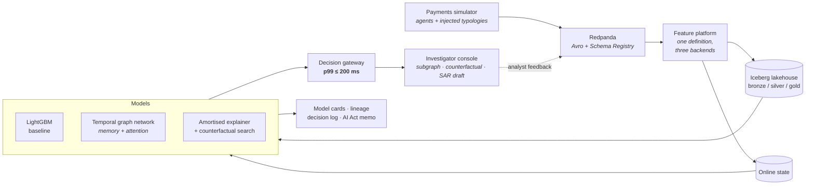

<h1 align="center">KONTOGRAPH</h1>

<p align="center">
  <strong>Real-time anti-money-laundering detection for SEPA Instant payments.</strong><br>
  A streaming decision system that scores, explains and logs every payment inside a 200 ms budget —<br>
  with the evaluation machinery to show that its numbers, and its explanations, hold up.
</p>

<p align="center">
  <a href="https://github.com/aabolfadl/kontograph/actions/workflows/ci.yml"></a>
  <a href="docs/evaluation-protocol.md"></a>
  <a href="LICENSE"></a>
</p>

---

## The problem

Regulation (EU) 2024/886 made **SEPA Instant** credit transfers mandatory across
the euro area: a euro payment between any two accounts must settle in **under
ten seconds**, around the clock, with no upper amount limit and mandatory
**Verification of Payee** (VoP). Before this, the settlement delay was doing
invisible work. It gave banks an overnight batch window to look for suspicious
patterns, and it gave them time to _recall the money_ when they found one.

Both are gone. Settlement is irrevocable within seconds, and laundered funds are
typically forwarded on immediately. Detection therefore has to happen _inside_
the payment, while the customer waits, and speed alone is not sufficient:

- **The decision has to be right.** Blocking a legitimate salary payment is a
  serious harm in its own right, and an institution's investigation team has a
  fixed daily capacity.
- **The decision has to explain itself.** GDPR Art. 22 gives a person subject to
  an automated decision the right to meaningful information about the logic
  involved, and a suspicious-activity report (_Verdachtsmeldung_) filed with the
  FIU must state grounds. "The model said so" is not a report.
- **The explanation has to be faithful** to what the model actually did, which
  is the requirement most systems leave unmeasured.

KONTOGRAPH implements that system end to end — simulator, event stream,
lakehouse, feature platform, models, serving gateway, governance artifacts and
investigator console — together with the evaluation machinery that makes its
reported numbers checkable.

---

## Design principles

The architecture follows from ten principles. Code, ADRs and documentation
reference them by number (e.g. _design principle P2_).

**P1 — A transaction is an edge, not a row.** Tabular models ask whether a
payment is unusual. The useful question is whether it is unusual _given who the
two parties are to each other and to everyone else_. The payment network is
modelled as a continuous-time dynamic graph: accounts are nodes, payments are
timestamped edges, and a **Temporal Graph Network** gives each account a learned
memory that updates whenever it transacts. That memory is what rung 4 adds.
[ADR-0006](docs/adr/0006-continuous-time-tgn.md)

**P2 — Time is the adversary, not a column.** Every leakage bug in financial ML is a
time-travel bug: an edge from the future in a graph snapshot, a window that
closes after the label, a random instead of chronological split. Point-in-time
correctness is a **hard invariant enforced in code and checked in CI**. A
property-based suite ([Hypothesis](https://hypothesis.readthedocs.io/))
generates random payment streams and asserts that no feature depends on any
event at or after its own timestamp — then **rewrites the future**, changing
every event after time `t`, and asserts that nothing computed before `t` moves.

**P3 — Offline and online are the same computation.** Training-serving skew is
the most common way a model that tested well fails in production. Each feature
is written **once** in a small DSL, lowered to a typed intermediate
representation, and compiled to three backends — **DuckDB SQL** (backfill),
**Flink SQL** (streaming) and an **incremental executor** (serving).
`kg features verify` runs identical data through all three and fails the build
on a single mismatched value.
[ADR-0005](docs/adr/0005-own-feature-dsl.md)

**P4 — Latency is a modelling constraint, not an engineering afterthought.** The SLA (**p99 ≤ 200 ms**) lives in
configuration, not prose. A [k6](https://k6.io/) load test drives a
**constant arrival rate** — so a slowdown cannot hide behind fewer requests —
and fails the build if p99 exceeds the budget. Accuracy given up to meet it is
reported.

**P5 — Explanation under latency.** Perturbation-based graph explainers cost
seconds per instance. Investigators need the _subgraph and the counterfactual_,
not a feature-attribution bar chart. The explainability work has five goals:

- **P5.1 Amortised explanation** — a lightweight explainer distilled from an
  expensive perturbation-based teacher, predicting the salient temporal subgraph
  in one forward pass. [ADR-0007](docs/adr/0007-amortised-explainer.md)
- **P5.2 Faithfulness measured, not asserted** — comprehensiveness and
  sufficiency against the teacher as the fidelity ceiling, with the gap
  published.
- **P5.3 Actionable counterfactuals** — not "feature 17 had high attribution"
  but "remove these two hops through this intermediary and the score falls below
  the threshold", constrained to edits plausible in a payment network.
- **P5.4 Stability over time** — the same alert re-explained one tick later must
  tell the same story; an explainer that contradicts itself is worse than no
  explainer at all, so stability is measured across event ticks.
- **P5.5 The investigator surface** — subgraph view with the counterfactual
  highlighted, an auto-drafted bilingual (DE/EN) narrative fragment for the
  suspicious-activity report, and one-click analyst feedback that flows back as
  a training signal.

**P6 — Optimise what the institution pays for.** ROC-AUC on a 0.1%-positive
problem is decoration. The operating metrics are **precision@k and recall@k with
k set to analyst capacity**, cost-weighted expected loss, and alert-to-SAR
conversion.

**P7 — Labels arrive late, incomplete and biased.** Confirmed labels arrive weeks
later, only for investigated cases, which are only cases the incumbent system
flagged. The data contract separates `decided_ts` (when the verdict was reached)
from `event_ts` (when the payment happened), which makes verification delay
measurable and lets models be retrained under 14/30/60-day label latency. The
simulator generates the selection bias explicitly: evasive campaigns are
confirmed at roughly half the rate of obvious ones.

**P8 — Governance is code, or it is theatre.** Model cards, data lineage and decision logs are
**generated by the pipeline**, versioned, and reproducible from a commit hash.

**P9 — Build a better problem than the public datasets offer.** No real banking
data is used. Instead an **agent-based simulator of German retail payments**,
calibrated against public Bundesbank and EBA aggregates, injects laundering
typologies under known ground truth. It provides what no public dataset does:
the true causal structure of the crime, and therefore the true size of the label
gap.

**P10 — A system is demonstrated only if it runs.** One command brings up the
full stack locally (`make up`); the investigator console is self-contained, with
no sign-up, no CDN and no build step, and is comprehensible within ten seconds.

### Engineering invariants

- **No leakage.** Enforced by tests, not vigilance.
- **No unreproducible number.** Every figure in this README regenerates from a
  command, and every artifact carries dataset fingerprint, feature-set hash,
  model version, code commit and protocol hash.
- **No claimed capability without an artifact.**
- **No synthetic data passed off as real.** The simulator is described as a
  simulator everywhere.
- **No metric chosen after seeing the results.** The evaluation protocol was
  committed before any model was trained; the git history is the evidence.

---

## Architecture



---

## Status

| Milestone | State |
| --- | --- |
| **M0** Foundations — workspace, contracts, CI, ADRs, frozen evaluation protocol | ✅ |
| **M1** Simulator — agents, typologies, ground truth | ✅ |
| **M2** Streaming spine — event log to lakehouse, quality gates, orchestration | ✅ |
| **M3** Feature platform — DSL, three compilers, point-in-time suite | ✅ |
| **M4** Baseline — LightGBM, calibration, cost-optimal threshold | ✅ |
| **M5** Temporal graph network and amortised explainer | ⬜ |
| **M6** Serving — gateway, decision log, load test, latency budget | ⬜ |
| **M7** Governance — model cards, lineage, AI Act memo | ⬜ |
| **M8** Investigator console and technical write-up | ⬜ |

### Beyond M8

1. Disparate-impact analysis across simulated customer groups.
2. Federated training across simulated Sparkassen with differential privacy —
   the shape of the real German institutional problem.

---

## Getting started

```bash
git clone https://github.com/aabolfadl/kontograph.git && cd kontograph
make setup        # installs the uv workspace into .venv
make doctor       # checks this machine can run the stack
make up           # Redpanda, MinIO, Redis, MLflow
make ci           # lint, types, contract gate, tests
```

## License

[MIT](LICENSE)
