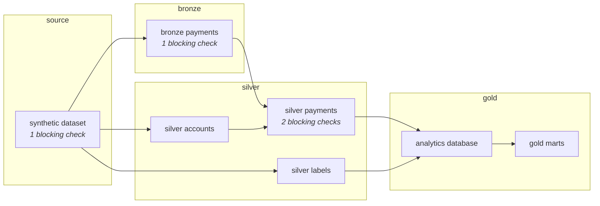

# Data lineage

> Generated 2026-08-04 11:05 UTC by `kg gov lineage`. **Static fallback** — Dagster is not installed in this environment, so the diagram is read from a declaration rather than derived. Install the `orchestration` extra to generate it from the real graph.



## Assets

| Asset | Layer | Depends on | Blocking checks |
|---|---|---|---|
| `synthetic_dataset` | source | — | `dataset_is_reproducible` |
| `bronze_payments` | bronze | `synthetic_dataset` | `bronze_quality_gate` |
| `silver_accounts` | silver | `synthetic_dataset` | — |
| `silver_labels` | silver | `synthetic_dataset` | — |
| `silver_payments` | silver | `bronze_payments`, `silver_accounts` | `silver_referential_integrity`, `labels_never_precede_their_events` |
| `analytics_database` | gold | `silver_payments`, `silver_labels` | — |
| `gold_marts` | gold | `analytics_database` | — |

## What the blocking checks guarantee

A failing blocking check stops downstream assets from materialising. These are not assertions buried inside a transform — they are Dagster asset checks, visible in the UI and in the run history.

| Check | Guards against |
|---|---|
| `dataset_is_reproducible` | the dataset no longer regenerating byte-identically, which is the premise ADR-0009 rests on when it replaces DVC with content hashing |
| `bronze_quality_gate` | structurally invalid payments reaching silver. On its first run it blocked a promotion on `debtor_and_creditor_differ` and exposed a real simulator bug |
| `silver_referential_integrity` | dangling account references, which would make a mart quietly produce nulls instead of failing |
| `labels_never_precede_their_events` | a label decided before its transaction happened — a time-travel bug, caught at the cheapest possible place |

## Time travel

Every Iceberg table keeps its snapshot history, so the state of any layer at any past instant is recoverable:

```bash
kg lake history bronze.payments   # snapshot id, parent, timestamp, records added
kg lake status                    # row counts and snapshot counts per table
```

The DuckDB analytics database records which Iceberg snapshot each mart was built from, in its `_lineage` table — so a number in a mart is traceable to the exact table state that produced it.

_Current dataset: `full-34f751e78a91`_